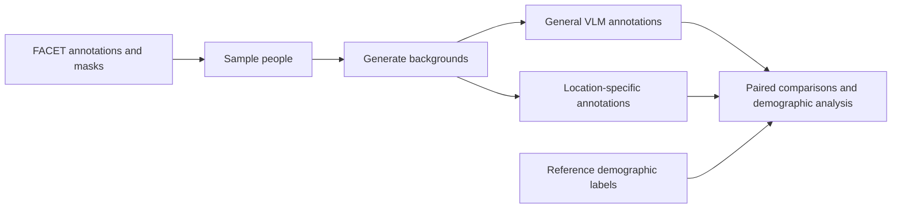

# Demographic Bias in Generated Visual Contexts

Summer SURF research project investigating how demographic appearance relates to AI-generated environments and how vision-language model (VLM) judgments change across image contexts.

The experiment selects people from FACET, generates alternative backgrounds while attempting to preserve each person, annotates the original and generated images with a VLM, and compares demographic predictions and scene attributes.

## Pipeline



The main experiment covers nine settings: shopping mall, public park, restaurant, sports stadium, religious site, cultural site, office building, public transport, and street.

## Setup

Use Python 3.11 or newer. Image generation requires a CUDA-capable NVIDIA GPU, an appropriate PyTorch installation, and enough GPU memory for the chosen model. Annotation requires a running Ollama server with a vision-capable model installed.

```bash
python -m venv .venv
source .venv/bin/activate
python -m pip install -r requirements.txt
# For image generation, also install:
python -m pip install -r requirements-generation.txt
```

On Windows, activate with `.venv\Scripts\Activate.ps1`. Dependencies are unpinned because the export did not include its original environment; these files are dependency inventories, not a verified reproduction lockfile. Install a PyTorch build appropriate for your CUDA environment.

## Configuration and credentials

Scripts read configuration from environment variables. `.env.example` documents the supported settings; scripts do not automatically load `.env` files.

```bash
export FACET_ROOT=/path/to/facet
export GPU_INDEX=0
export OLLAMA_URL=http://localhost:11434
# Optional: otherwise Hugging Face uses its default cache.
export MODEL_CACHE_DIR=/path/to/model-cache
# Enter a NEW token without storing it in shell history:
read -rsp 'Hugging Face token: ' HF_TOKEN; echo
export HF_TOKEN
```

Model access may require accepting the provider's terms. Never commit tokens. A token was present in the original private export; revoke it and use a new token. Sanitizing this copy does not revoke credentials or modify the original export.

`GPU_INDEX` defaults to 0 and is relative to devices visible through `CUDA_VISIBLE_DEVICES`. The experimental Klein scripts default to `START_POSITION=0`. Set `HF_HUB_OFFLINE=1` to use already-cached models without downloads.

Expected dataset layout:

```text
$FACET_ROOT/
  annotations/annotations.csv
  annotations/coco_masks.json
  imgs_1/
  imgs_2/
  imgs_3/
```

Obtain FACET and model weights separately under their respective terms. Dataset images, person masks, and per-person annotations are not included here.

## Running the main pipeline

Run commands from the repository root. Review the sampling settings in `image_selection.py` before running; the target sample size may exceed the number of eligible images.

```bash
python image_selection.py
python inpainting.py
python cross_image_annotations.py --images-root places_inpainting_results --model qwen3-vl:8b-instruct
python location_attribute_annotations.py --images-root places_inpainting_results --model qwen3-vl:8b-instruct
```

The supplied question and label JSON files provide the evaluation definitions. Optional taxonomy regeneration:

```bash
python final_attributes.py --n-attrs 16 --n-labels 6
```

This overwrites the location taxonomy. Keep a copy of the exact taxonomy and model configuration used for each experiment.

### Reference labels required for analysis

The exported project does not include the script that creates `ground_truth.json`. Before running analysis, supply one file per person folder, using the original dataset annotations and a documented policy for resolving multiple annotators:

```text
places_inpainting_results/<image-id>/
  original.png
  <location>.png
  cross_image_annotations.json
  location_attribute_annotations.json
  ground_truth.json
```

Expected reference-label schema (illustrative values only):

```json
{
  "person_id": "example-person-id",
  "image_file": "example.jpg",
  "gender": "female",
  "age": "young",
  "skin_tone": 3
}
```

Gender values are `male`/`female`; age values are `young`/`middle`/`old`; skin tone uses the 1–10 scale. These are dataset presentation labels, not verified personal identities. Do not substitute sampler bucket labels for reference skin-tone scores.

```bash
python analysis_dashboard.py --images-root places_inpainting_results
python location_attribute_demographic_analysis.py --images-root places_inpainting_results
python plot_selected_demographic_differences.py --interactive
```

## Script map

| Script | Purpose |
| --- | --- |
| `image_selection.py` | Sample FACET images with person masks and demographic groups |
| `inpainting.py` | Main FLUX.1 Fill background generation workflow |
| `cross_image_annotations.py` | General image questions, resumable VLM annotation |
| `location_attribute_annotations.py` | Annotate location-specific attributes |
| `analysis_dashboard.py` | Aggregate accuracy, original/generated stability, and charts |
| `location_attribute_demographic_analysis.py` | Compare attribute frequencies across demographic groups |
| `plot_selected_demographic_differences.py` | Plot selected demographic comparisons |
| `final_attributes.py`, `generate_attributes.py` | Generate label taxonomies and question definitions |
| `caption.py` | Optional free-form image captioning |
| `places_vlm.py` | Experimental FLUX.2 Klein location editing |
| `vlm_inpainting.py`, `sdxl_inpainting.py` | Experimental object-conditioned generation |
| `plot_bias_by_demographics.py` | Earlier demographic plot workflow; requires separately produced label annotations |

## Scope and limitations

- The original saved analysis reported 665 person folders and 6,650 image records, including originals. This cleaned copy has not rerun that experiment.
- Generation prompts request person preservation; they do not establish that identity, clothing, or pixels remain unchanged.
- Observed differences can reflect generator behavior, VLM measurement error, and source-image differences.
- Race in location comparisons is the VLM's original-image prediction, not a ground-truth identity label.
- Significance tests use unadjusted two-proportion p-values. When there are more than two demographic groups, the code compares the two largest. Treat results as exploratory.
- File claims use PID checks and timeouts. They are intended for workers on one host, are not a distributed scheduler, and have no heartbeat. Timeout reclamation can conflict with a long-running worker; stale-lock cleanup is not a fully atomic protocol.
- The retained experimental scripts are research prototypes, not validated production infrastructure.

## Repository checks

```bash
python tools/check_repository.py
git diff --check
```

The standard-library checker verifies Python syntax, JSON parsing, common credential patterns, and the nine-location definition without loading models or importing GPU dependencies. It does not replace a full secret scanner or GPU integration testing.

See [PREPARATION.md](PREPARATION.md) for the cleanup scope. No license was assumed; choose one with the project owner before granting reuse rights.
